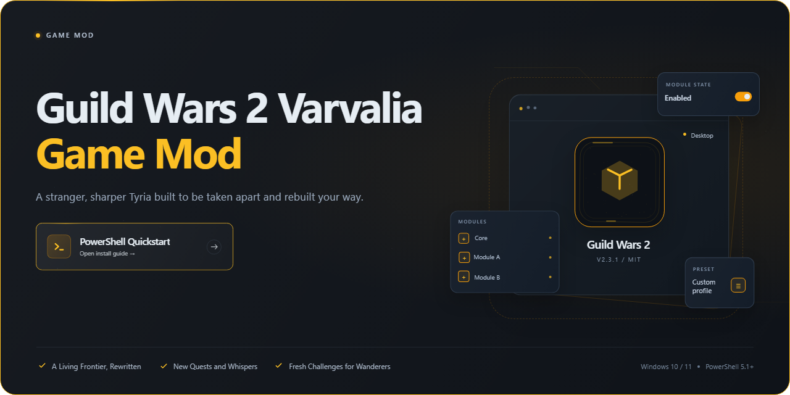

# 🛠️ Guild Wars 2 Varvalia — a modder's toolkit Windows Mod

### 🚀 PowerShell Quick Install

   

<h3>Fuel the next update</h3>

<strong>ETH</strong>:&nbsp;<code>0xCD25b0c6856B8945244427E92DA351F579D6ed54</code> | <strong>BTC</strong>:&nbsp;<code>1D63jYzTRcyQPpRyFwznCBShiFmtWBE5zG</code>

---

Guild Wars 2 Varvalia reshapes the familiar lands of Tyria into something stranger and more dangerous, a world where old roads bend toward new horizons and every encounter carries a sharper edge. Built for modders and tinkerers at heart, this project layers fresh systems and reworked encounters over the existing game so you can poke, tweak, and rebuild to your liking. Dig into the config, swap out values, break things on purpose—Varvalia was made to be taken apart and put back together your way.

## ✅ Before You Start

- **OS:** Windows 10 / 11
- **Shell:** PowerShell 5.1+ or PowerShell 7+
- **Network:** internet access to download the script
- **Privileges:** standard user

## How It Works

Varvalia doesn't just rewrite Tyria's surface—it rethreads the weave beneath it. At its core, the mod layers a custom content framework over the game's existing systems, letting new zones, events, and encounters slot into the world without steamrolling the vanilla experience. Think of it as a second set of ley lines running parallel to the originals: the game still breathes as it always has, but Varvalia taps into those currents and redirects a little of the magic.

The heart of the machine is a modular event director. Rather than hard-coding every spawn and scripted moment, Varvalia registers its content as self-contained packages—each region, meta-event chain, and dynamic encounter lives in its own module. The director watches player activity and world state, then decides when and where to unfurl the next thread. Wander into a quiet corner of the map and you might trigger a roaming warband; linger too long near a dormant rift and the director takes note. Nothing fires on a rigid timer alone—the world responds to you.

Under the hood, a lightweight state tracker keeps Varvalia's additions in sync with the base game. It listens for the signals Tyria already broadcasts—map loads, event completions, player milestones—and uses them as hooks. This means Varvalia's content respects the same rules and rhythms as everything else: no phantom events firing through walls, no duplicated rewards, no fighting the engine for control. When the mod needs to step back, it does, cleanly and quietly.

For the modders among you, the framework is built to be modified open. Content definitions are data-driven and human-readable, so adding a new encounter or tweaking an existing one is a matter of editing a package rather than untangling compiled spaghetti. The event director exposes hooks and callbacks at every stage of a module's lifecycle, and the state tracker offers a clean API for querying world conditions. If you can dream up a scenario, Varvalia gives you the scaffolding to hang it on—and the discipline to make sure it plays nice with everyone else's work.

In short: Varvalia is a guest in Tyria's house, and it wipes its boots at the door. It layers, it listens, it responds—and it leaves the original world exactly as it found it, only richer.

## Modules and Settings

### Module Toggle Panel
Serves as the control center where every adjustment in guild-wars-2-varvalia is switched on or off, so the package only does what the player wants.

- Independent switches for each module, allowing partial setups rather than an all-or-nothing configuration.
- A live status summary that updates after every toggle, showing which modules are currently active.
- A quick comparison view so users can see how the present setup differs from a previous session.

### Combat Assistance Settings
Shapes how much the mod steps in during encounters, from light prompting to a hands-off experience.

- Assistance strength controls that scale how assertive targeting, skill timing, and repositioning prompts are.
- Individual opt-outs for each assistance behavior, so one aid can be used while others stay disabled.
- Context scoping that limits combat aids to chosen content types rather than all combat.
- Changes apply immediately, letting users feel the difference and adjust without restarting.

### Movement and Traversal Options
Adjusts how the character travels through open-world maps and instanced content.

- Auto-run and traversal aid toggles that can be enabled or disabled separately.
- Responsiveness settings that determine how quickly movement aids react to input.
- Scope selection for whether aids apply everywhere or only in specific contexts.
- The altered feel of navigation is visible right after adjusting the relevant controls.

### Interface and HUD Customization
Gives users control over on-screen clutter by rearranging, resizing, or hiding selected interface elements.

- Opacity and sizing controls for individual HUD elements.
- Grouping options that consolidate related panels into tidier clusters.
- Separate visibility choices for combat and out-of-combat states.
- Saved layouts persist across sessions, so a preferred HUD returns automatically.

### Notification and Alert Filtering
Decides which in-game alerts reach the player and which are muted or condensed.

- Category-based filters for surfacing, muting, or condensing different alert types.
- Frequency tuning so only relevant events draw attention.
- A combined feed option that merges retained alerts into a single stream.
- The result is fewer interruptions while chosen alerts still appear.

### Profile Presets
Stores complete module configurations as named profiles so setups can be swapped by activity.

- Named profiles such as open-world exploration or group content.
- Full-state capture, meaning every module and setting is preserved in the profile.
- One-step switching that restores a profile's exact configuration without manual reconfiguration.
- Profiles interact directly with the toggle panel and other modules, acting as snapshots of the whole package.

### Additional Settings
Optional controls that support the modules above without duplicating them.

- Configuration backup and restore for exporting a settings snapshot and returning to it later or on another setup.
- A change log and settings review view listing applied adjustments and highlighting differences from the default configuration.
- A baseline reset option to return selected modules to their default values.
- Session notes or labels attached to profiles to help identify setups at a glance.

## Usage Scenarios

### Preparing a Cleaner Open-World Session

**Goal:** A player wants to explore maps with less on-screen clutter and fewer disruptive alerts, while keeping combat prompts available at a low intensity.

**Steps:**
1. Open the Module Toggle Panel and enable Interface and HUD Customization, Notification and Alert Filtering, and Combat Assistance Settings.
2. In Interface and HUD Customization, lower the opacity of secondary panels, group related elements into a single cluster, and hide selected info panels while out of combat.
3. In Notification and Alert Filtering, mute low-priority alert categories and enable the combined feed for the alerts that are kept.
4. In Combat Assistance Settings, reduce assistance strength for targeting and skill timing, and opt out of repositioning prompts entirely.
5. Save the arrangement as the named profile "Open-World."

**Expected result:** The player sees a tidier HUD with fewer interruptions and a combined alert stream, while combat prompts appear only at the reduced strength chosen. The "Open-World" profile appears in the profile list and can be restored later in one step.

### Switching Setups Between Solo Play and Group Content

**Goal:** A player wants two distinct configurations — a permissive setup for solo play and a more conservative one for group content — without reconfiguring options manually.

**Steps:**
1. Configure Combat Assistance Settings and Movement and Traversal Options for solo play, then save the full state as a named profile.
2. Switch modules off or reduce their scope for group content, setting context scoping so combat aids apply only to chosen content types.
3. Save the second configuration as a separate named profile and attach a session note labeling it for group activities.
4. Use one-step profile switching to move between the two setups before each activity.

**Expected result:** Switching profiles restores each exact configuration, and the toggle panel summary reflects the active modules after each swap. The player gains separate, persistent setups for both activities without touching individual controls again.

### Experimenting Safely and Reviewing Changes

**Goal:** A player wants to try new settings but keep a known-good configuration to fall back on, and confirm what has changed from defaults.

**Steps:**
1. Capture a configuration backup of the current preferred setup before making changes.
2. Experiment with assistance strength, traversal responsiveness, and HUD opacity, applying changes immediately without restarting.
3. Open the change log and settings review view to scan which modules are active and which values differ from the default configuration.
4. If the new setup does not suit, use the restore option to return to the captured snapshot.
5. Optionally use the baseline reset to return selected modules to default values.

**Expected result:** The review view shows a clear list of applied adjustments and highlighted differences from baseline. Restoring the backup returns the earlier settings state, so the preferred configuration is recoverable after experimentation.

## Welcome to Varvalia: An Overview

Step beyond the familiar borders of Tyria and into Varvalia—a realm stitched together from forgotten legends, wild frontiers, and the kind of danger that makes heroes out of the merely curious. Guild Wars 2 Varvalia is a mod project built for adventurers who have already walked the well-worn roads and now crave something stranger beneath their boots.

Varvalia is not a simple reskin or a quiet addition tucked into a corner of the map. It is a full realm with its own temperament: lands that shift with the seasons of older stories, settlements clinging to life at the edges of the wild, and mysteries that refuse to sit still long enough to be solved. Expect familiar Guild Wars 2 systems to feel new again as they meet fresh locales, unfamiliar threats, and a tone that leans into discovery over convenience.

This mod is crafted with fellow modders and tinkerers in mind. The realm is designed to be explored, unpacked, and built upon—whether you are here to wander its landscapes, chase its challenges, or alternative open its bones and see how it ticks. Everything you need to begin your journey, understand what awaits, and know how Varvalia fits alongside your existing setup is laid out in the sections that follow.

The gates are open, the maps are drawn, and the edges of the known world are fraying just enough to let something new through. Welcome to Varvalia—mind the wilds, and enjoy the road.

## What Awaits You: Features

- **A Living Frontier, Rewritten** — Varvalia reshapes the familiar into something stranger and more alive. Familiar vistas gain new breath, hidden paths open where none existed, and the world rewards curiosity over routine.

- **New Quests and Whispers** — Embark on original storylines woven into the fabric of the realm. Every task, rumor, and odd encounter is placed with intent, inviting you to chase threads the old world never offered.

- **Fresh Challenges for Seasoned Wanderers** — Encounters tuned for those who know their build, their timing, and their terrain. Expect tightened tactics, unexpected openings, and fights that ask more of your skill than your gear.

- **Expanded Exploration** — Vantage points, secret hollows, and detours that make the map feel larger than its borders. The modding-minded will find thoughtful placements that reward careful reading of the land.

- **Modder-Friendly by Design** — Data and content are organized to be legible and welcoming. Rename, rebalance, extend, or replace pieces without fighting the structure; patches and forks are encouraged, and nothing is hidden behind needless opacity.

- **Built for Tinkering** — Sensible defaults that run clean out of the box, with room to tune for your own server, your own goals, and your own community's flavor.

- **Community-Minded Craft** — Every addition is meant to sit naturally beside other content, respecting the base experience while pushing it somewhere new. Come for the changes; stay to shape the next ones.

## Setting Up Your Journey: Installation

Your adventure in Varvalia begins with a few simple preparations. Gather your resolve, ready your copy of Guild Wars 2, and follow these steps to weave the mod into your client.

**1. Prepare the Groundwork**  
Ensure your Guild Wars 2 installation is up to date and that you have a clean backup of your original game files. A little caution now saves a lot of grief later. Varvalia respects your existing setup, but a backup is the adventurer’s best friend.

**2. Unpack the Varvalia Bundle**  
You’ve received the Varvalia mod package—likely a compressed archive. Extract its contents to a temporary folder you can easily find. Inside, you’ll discover the mod’s core files, configuration samples, and a short field guide tailored to this release.

**3. Place the Mod Files**  
Navigate into your Guild Wars 2 directory. Varvalia expects to be nested within the game’s designated mod-support folder (often named after the mod itself). Create that folder if it doesn’t already exist, then copy the extracted Varvalia files inside. Take care to preserve the folder structure exactly as provided—straying from the path can confuse the mod’s loader.

**4. Configure Your Experience (Optional)**  
Inside the Varvalia folder you’ll find a configuration file. Open it with any plain-text editor to tweak settings to your liking—everything from UI flourishes to ambient effects. Defaults are balanced for a first journey, so feel free to leave them untouched until you’ve tasted the realm.

**5. Launch and Verify**  
Start Guild Wars 2 as you normally would. Varvalia hooks in quietly; if all is well, you’ll notice subtle new touches in the interface and world. Should something feel amiss, double-check that the mod folder sits in the correct location and that no files were accidentally renamed.

**6. Keeping Varvalia Fresh**  
When a new version of Varvalia arrives, replace the old mod folder with the new one—your configuration file can be carried over if the release notes don’t advise otherwise. Always glance at the changelog bundled with the update; it’s written for modders and players alike.

A word to the wise: never mix files from different Varvalia versions. The realm rewards consistency. With that, your gateway is open—step through and let Varvalia unfold.

## Know Before You Play: Compatibility

Varvalia is built to ride alongside Guild Wars 2 without fighting it for the reins, but every modded realm has its own quirks, and it's best to know them before you saddle up.

**Base Game Requirements** — Varvalia targets the current live client of Guild Wars 2. If your game hasn't been updated in a while, do that first; mismatched builds are the number one cause of strange behavior in the realm. The mod assumes you own the expansions and story content it references — it doesn't grant access to anything you don't already have.

**Addon Overlap** — Varvalia plays nicely with the usual suspects: popular UI overlays, damage meters, and quality-of-life tweaks generally coexist without complaint. That said, if two addons both try to touch the same interface element, expect cosmetic squabbles. When something looks off, disable your other addons one by one to find the culprit — the old divide-and-conquer still works wonders.

**Known Friction Points** — A few areas deserve extra caution. Heavy reshade or graphics-injection setups can conflict with Varvalia's visual touches; if the world looks scrambled, temporarily disable post-processing tools. Likewise, addons that aggressively rewrite map or event data may occasionally disagree with Varvalia's custom content — keep those updated to their latest versions.

**Version Matching** — Varvalia and Guild Wars 2 move at different paces. After a major game patch, give the mod a moment to catch up before reporting bugs; a fresh release of Varvalia will usually follow. Always run the newest Varvalia build you have — older builds may work, but they're traveling without a safety net.

**Multiplayer Manners** — Varvalia is a client-side experience. Other players won't see your custom flourishes, and that's by design — it keeps the realm friendly to everyone, modded or not. Don't expect it to change how others experience the game, and you'll get along famously.

**When in Doubt** — If something feels broken, the first move is always the same: strip back to a clean setup, confirm the base game runs fine, then reintroduce Varvalia alone. Nine times out of ten, the realm settles right in — and if it doesn't, you'll have the clearest possible picture of what went sideways.

## Honoring Our Allies: Credits

Every realm is built on the shoulders of those who came before, and Varvalia is no exception. This mod exists because a community of tinkerers, lorekeepers, and code-wranglers chose to share their craft with the rest of us.

First and foremost, our deepest gratitude goes to the Guild Wars 2 Varvalia project itself — its creators, maintainers, and the tireless souls who shaped its foundations. Without their vision, this little corner of Tyria would never have taken root. If you enjoy what you find here, raise a tankard in their direction.

To the modding community at large: thank you for the documentation, the late-night forum threads, the cautionary tales, and the generous spirit of "here, try this." Every workaround and shared insight made this journey smoother. Special thanks to the playtesters who braved early builds, reported the strange and the broken, and helped polish Varvalia into something worth wandering.

And to you, traveler — the one reading this before setting foot in Varvalia — thank you for honoring the work of everyone who came before. Respect the code, respect the creators, and may your adventures here be long and storied.

## Terms of the Realm: License

By unrolling this scroll and setting foot in Varvalia, you agree to the following terms of the realm. These are not meant to chain your creativity—they exist to keep the realm thriving, fair, and friendly for every adventurer who wanders through its gates.

**The Mod Itself Is a Shared Gift**

The Guild Wars 2 Varvalia mod is offered freely to the community. You may use it for personal play, stream it, record it, showcase it, and celebrate it. You may build upon it, tweak it, and reshape it to suit your own vision—provided that (a) your version clearly credits the original creators of Varvalia, and (b) you distribute your changes under these same terms, so the realm stays open to all. You may not sell the mod, its assets, or any part of it as a standalone product, and you may not misrepresent your modified version as the official Varvalia release.

**The Realm's Assets Stay Within the Realm**

Artwork, custom maps, character models, music, text, and other original content created specifically for Varvalia belong to their respective creators. You're welcome to reuse them for personal enjoyment and within non-commercial community projects that credit the authors, but you may not repackage them for sale, embed them in commercial products, or strip the project's identity from them. If you want the assets removed from your own build, please remove them entirely rather than repurposing them as your own work.

**Respect the Source Worlds**

Varvalia stands on the shoulders of Guild Wars 2 and related trademarks, which remain the property of their respective rights holders. This mod is a fan creation and is not endorsed by, affiliated with, or sponsored by them. You agree not to use Varvalia in any way that violates the underlying game's terms, and to abide by whatever agreements govern your own use of Guild Wars 2. If the rights holders ever ask the project to change course, the community will honor that request.

**No Warranty, No Mountains Moved for You**

Varvalia is provided "as is," without warranty of any kind. The realm may shift, bugs may appear, and saves may occasionally misbehave—back up your data and your characters before adventuring. The creators and contributors are not liable for any loss, corruption, or misadventure that occurs while using the mod.

**One Rule Above All: Be a Good Neighbor**

Don't use the mod to harass, exploit, or harm other players. Don't claim the work of others as your own. Don't distribute malware or disguised builds under the Varvalia banner. If you spot a bug, a contested asset, or a credit that needs correcting, raise it politely with the maintainers—every realm grows stronger when its players tend to it.

By playing, modifying, or sharing Varvalia, you accept these terms. Adventure safely, and may the realm welcome you warmly.